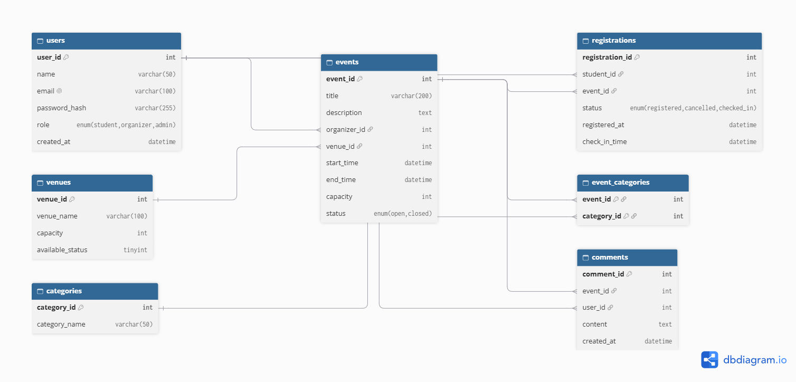

# 校园活动报名与管理系统

**Campus Event System** · 基于 Flask + MySQL 的全栈校园活动管理平台，支持「学生报名」与「组织者管理」两大角色，内置基于签名令牌的安全认证与并发安全的活动报名。

## 目录

- [功能特性](#功能特性)
- [技术栈](#技术栈)
- [数据库设计](#数据库设计)
- [项目结构](#项目结构)
- [快速开始](#快速开始)
  - [环境要求](#环境要求)
  - [手动安装](#手动安装)
  - [一键安装](#一键安装)
- [认证与安全](#认证与安全)
- [API 接口](#api-接口)
- [业务规则](#业务规则)
- [管理员](#管理员)
- [测试](#测试)

## 功能特性

- **双角色自助注册**：学生报名活动；组织者发布 / 编辑活动、负责签到与报名管理。
- **安全认证**：登录签发 `Bearer Token`，服务端从令牌解析身份，不信任前端传来的用户标识。
- **并发安全报名**：事务 + 行锁（`SELECT ... FOR UPDATE`）防止名额超卖。
- **完整业务闭环**：发布 → 报名 → 签到 → 评论 → 取消 / 重新报名，覆盖活动全生命周期。
- **活动分类**：活动支持多分类（N:M），发布时可多选，大厅支持按分类筛选。
- **权限精细管控**：按「角色 + 资源归属」双重校验（学生 / 组织者 / 管理员）。
- **统一响应规范**：所有接口返回 `{"code", "message", "data"}` 结构，分页接口附带分页元信息。
- **自动化测试**：pytest 覆盖认证、边界校验、并发报名、签到、评论、分类、限流、权限等核心场景。

## 技术栈

| 层次 | 技术 |
| --- | --- |
| 后端 | Python 3.10+ · Flask 3 · Flask-Cors · mysql-connector-python · bcrypt · itsdangerous · python-dotenv |
| 数据库 | MySQL 8.0+（utf8mb4，状态字段使用 `enum` 约束） |
| 前端 | HTML5 · CSS3 · 原生 JavaScript（Fetch API），由 Flask 直接托管 |
| 认证 | 签名令牌（Bearer Token），默认 24 小时过期，`TOKEN_MAX_AGE` 可配 |
| 测试 | pytest |
| 开发工具 | VS Code · MySQL Workbench · Postman |

## 数据库设计

共 7 张业务表，建表脚本见 [`database/schema.sql`](database/schema.sql)。



| 表 | 说明 | 关键约束 |
| --- | --- | --- |
| `users` | 用户（学生 / 组织者 / 管理员） | `email` 唯一；`role` 为 `enum` |
| `venues` | 场地 | `available_status` 标记是否可用 |
| `events` | 活动 | `organizer_id` / `venue_id` 外键；`status` 为 `enum('open','closed')`；`CHECK (capacity > 0)`、`CHECK (end_time > start_time)`；`start_time` 建索引 |
| `registrations` | 报名记录 | `UNIQUE(student_id, event_id)` 防重复报名；`status` 为 `enum('registered','cancelled','checked_in')` |
| `categories` | 活动分类 | — |
| `event_categories` | 活动 ↔ 分类（N:M） | 复合主键 `(event_id, category_id)`，双向外键级联 |
| `comments` | 活动评论 | `event_id` / `user_id` 外键，双向外键级联；`idx_event(event_id)` |

关系要点：

- 一个组织者可发布多个活动（1:N），一个活动归属一个场地（N:1）。
- 一个学生可报名多个活动，一个活动可被多个学生报名（N:M，通过 `registrations` 关联）。
- 一个活动可挂多个分类（N:M，通过 `event_categories` 关联）。
- 删除活动时：`comments` / `event_categories` 由 DB 外键级联清理，`registrations` 由应用层显式清理（见 `delete_event()`）。

建表脚本同时写入基础种子数据：4 个活动分类、5 个场地。

## 项目结构

```text
CampusEventProject-fixed/
├── backend/
│   ├── app.py              # 后端主程序（路由、认证、事务逻辑）
│   ├── init_db.py          # 初始化数据库（建库建表，--force 删表重建）
│   ├── make_admin.py       # 将已有账号提升为管理员
│   └── setup_env.py        # 交互式生成 .env
├── frontend/
│   ├── login.html          # 登录 / 注册页
│   ├── index.html          # 活动大厅（发布、报名、签到、评论、分类筛选）
│   └── profile.html        # 个人中心（我的报名、取消报名）
├── database/
│   └── schema.sql          # 建表脚本（含约束与基础场地 / 分类数据）
├── scripts/
│   └── *.bat               # 一键安装 / 启动 / 停止脚本
├── tests/                  # pytest 自动化测试
├── docs/
│   └── er-diagram.png      # 数据库 ER 图
├── requirements.txt        # 运行时依赖
├── requirements-dev.txt    # 测试依赖（pytest）
├── .env.example            # 环境变量模板（复制为 .env 后填写）
└── .gitignore              # 忽略 .env / 虚拟环境 / 缓存
```

## 快速开始

### 环境要求

- Python 3.10+（安装时勾选 *Add python.exe to PATH*）
- MySQL 8.0+
- Git（可选，用于克隆仓库）

### 手动安装

1. 安装依赖

   ```bash
   pip install -r requirements.txt
   ```

2. 初始化数据库（会创建 `campus_events` 库并重建所有表）

   ```bash
   mysql -u root -p < database/schema.sql
   ```

   也可以使用项目自带脚本（会读取 `.env` 中的连接信息，且对老库幂等补齐索引）：

   ```bash
   python backend/init_db.py
   ```

   初始化演示数据（方便第一次打开就有内容可看）：

   ```bash
   python backend/seed_demo.py
   ```

3. 配置环境变量：复制模板并生成应用密钥

   ```bash
   # Windows PowerShell
   Copy-Item .env.example .env
   python -c "import secrets; print(secrets.token_urlsafe(48))"
   ```

   将生成的随机串填入 `.env` 的 `APP_SECRET_KEY`，并填写数据库密码。`.env` 内容示例（**切勿提交到 git**）：

   ```ini
   # 数据库连接
   DB_HOST=127.0.0.1
   DB_PORT=3306
   DB_USER=root
   DB_PASSWORD=在这里填你的 MySQL 密码
   DB_NAME=campus_events

   # 应用密钥（用于签名登录令牌）
   APP_SECRET_KEY=在这里填一段随机长字符串

   # 令牌有效期（秒），默认 24 小时
   TOKEN_MAX_AGE=86400

   # 登录 / 注册限流（次数/窗口秒数）
   LOGIN_RATE_LIMIT=10/60
   REGISTER_RATE_LIMIT=20/3600

   # 调试模式：1 开启 / 0 关闭（生产环境请用 0）
   FLASK_DEBUG=0

   # 后端端口
   PORT=5000

   # 允许的跨域来源（逗号分隔，默认 * 表示全部）
   CORS_ORIGINS=*
   ```

4. 启动后端

   ```bash
   python backend/app.py
   ```

5. 浏览器访问 <http://127.0.0.1:5000/>（前端由 Flask 托管，无需额外开启 Live Server）。

### 一键安装

> 适合组员快速体验，前提是已装好 Python 3.10+ 与 MySQL。

1. 解压项目，**双击 `scripts/首次安装并启动.bat`**。
2. 脚本自动完成：创建 `.venv` 虚拟环境 → 安装依赖 → 引导填写数据库连接（生成 `.env`）→ 建库建表 → 启动服务并打开浏览器。
3. 后续使用双击 **`scripts/启动校园活动系统.bat`**（服务未运行则自动启动，已运行则直接打开浏览器）。
4. 关闭服务双击 **`scripts/停止校园活动系统.bat`**（只会停止本项目的进程，不会误杀其它占用端口的程序）。

说明：

- 首次安装输入的 MySQL 密码仅写入本机 `.env`，不会上传、也不会进入 git。
- `backend/init_db.py` 默认**不会**改动已存在的库；只有显式运行 `python backend/init_db.py --force` 才会删表重建。
- 启动 / 停止脚本会从 `.env` 读取 `PORT`，改端口后无需修改脚本。
- 换电脑 / 换同学重复「双击首次安装」即可，各环境配置相互独立。

## 认证与安全

- 登录成功后返回 `token`，前端保存到 `localStorage`，后续请求自动携带：

  ```text
  Authorization: Bearer <token>
  ```

- 服务端从令牌解析 `user_id`，**不信任前端传来的 `user_id` / `organizer_id`**。
- 令牌默认 24 小时过期，过期后前端自动跳回登录页。
- 密码使用 bcrypt 加盐哈希存储，校验规则为「≥8 位且包含大小写字母与数字」，并限制 bcrypt 72 字节上限。
- 登录按「IP + 邮箱」限流（默认 10 次 / 60 秒），注册按 IP 限流（默认 20 次 / 小时），超限返回 `429`；可通过 `LOGIN_RATE_LIMIT` / `REGISTER_RATE_LIMIT` 调整。
- 数据库凭据与应用密钥全部从 `.env` 读取，`.env` 已被 `.gitignore` 忽略；`APP_SECRET_KEY` 缺失时拒绝启动。
- 跨域来源由 `CORS_ORIGINS` 控制（默认 `*`，生产环境建议收紧为具体地址）。
- 前端对活动标题、描述、评论、用户名等用户输入统一做 HTML 转义，防范存储型 XSS。
- 所有接口的异常统一转换为 `{"code", "message", "data"}`，不向前端回显内部堆栈或 SQL 细节。

## API 接口

所有接口统一返回 `{"code", "message", "data"}` 结构，`code` 为业务码（2xx 成功、4xx / 5xx 失败）：

```json
{ "code": 200, "message": "ok", "data": { } }
```

出错时返回 `{"code", "message"}`（如 `{"code": 403, "message": "权限不足"}`），HTTP 状态码与 `code` 一致。分页接口额外返回 `total` / `page` / `page_size` / `pages`，`data` 仍为数组。

| 方法 | 路径 | 说明 | 权限 |
| --- | --- | --- | --- |
| POST | `/api/register` | 注册（学生 / 组织者） | 公开 |
| POST | `/api/login` | 登录，返回用户信息与令牌 | 公开 |
| GET | `/api/me` | 当前登录用户信息 | 登录 |
| GET | `/api/events` | 活动列表（`?page=&page_size=` 分页，`?category_id=` 按分类筛选） | 登录 |
| POST | `/api/register_event` | 报名活动（仅学生；事务 + 行锁，防超卖） | 学生 |
| GET | `/api/user_registrations/<user_id>` | 我的报名记录 | 仅本人 |
| PUT | `/api/cancel_registration/<registration_id>` | 取消报名 | 本人 / 该活动组织者 / 管理员 |
| POST | `/api/create_event` | 发布活动（可选 `category_ids`） | 组织者 |
| PUT | `/api/update_event/<event_id>` | 编辑活动（带 `category_ids` 时更新分类） | 该活动组织者 |
| DELETE | `/api/delete_event/<event_id>` | 删除活动 | 该活动组织者 / 管理员 |
| PUT | `/api/close_event/<event_id>` | 关闭 / 重新开放活动报名 | 该活动组织者 |
| GET | `/api/event_registrations/<event_id>` | 活动报名名单（分页） | 该活动组织者 |
| DELETE | `/api/remove_registration/<registration_id>` | 将学生移出活动 | 该活动组织者 |
| PUT | `/api/check_in/<registration_id>` | 学生签到 | 该活动组织者 / 管理员 |
| PUT | `/api/undo_check_in/<registration_id>` | 撤销签到（误签纠正） | 该活动组织者 / 管理员 |
| GET | `/api/venues` | 可用场地列表 | 登录 |
| GET | `/api/categories` | 活动分类列表 | 登录 |
| GET | `/api/comments/<event_id>` | 活动评论（分页） | 登录 |
| POST | `/api/comments` | 发表评论 | 登录 |
| DELETE | `/api/delete_comment/<comment_id>` | 删除评论 | 评论作者 / 活动组织者 / 管理员 |
| GET | `/api/admin/users` | 全部用户列表（分页） | 管理员 |

## 业务规则

- 只有学生账号可以报名；组织者负责发布 / 编辑 / 关闭活动与签到，管理员负责监管。
- 发布活动要求开始时间晚于当前时间、结束时间晚于开始时间、名额不超过场地容量，且不能选择已停用的场地。
- 报名要求：活动 `status='open'`、未开始、未结束、名额未满、未重复报名。
- 签到仅允许在活动开始后 ~ 结束前，由该活动组织者（或管理员）操作；已签到的报名不可再取消或移出，误签可通过「撤销签到」纠正。
- 已开始 / 已结束的活动不能重新开放报名。
- 编辑活动时，新名额不能小于当前有效报名人数。

## 管理员

管理员不能自助注册（注册页仅可选学生 / 组织者），需将已有账号提升：

```bash
python backend/make_admin.py someone@example.com
```

管理员可删除任意活动 / 评论、代组织者签到与撤销签到、取消任意报名，并在活动大厅的「用户管理」中查看全部用户。

## 测试

手动验收流程：

1. 注册一个学生账号和一个组织者账号（密码需 ≥8 位，含大小写字母与数字）。
2. 组织者发布活动（可选择分类），学生报名、取消、重新报名。
3. 并发测试：对满员活动同时发起多个报名请求，验证不再超卖。
4. 组织者签到 → 撤销签到 → 再次签到，验证状态流转正确。

自动化测试（需先初始化数据库并配置好 `.env`）：

```bash
pip install -r requirements-dev.txt

# 快速跑（不显示覆盖率）
pytest tests/ -q

# 看覆盖率
pytest tests/ --cov=app --cov-report=term-missing

# 生成 HTML 覆盖率报告
pytest tests/ --cov=app --cov-report=html
```

覆盖范围：认证与权限、输入边界、并发报名防超卖、取消 / 重新报名、签到与撤销签到、评论、分类、活动管理、分页、限流、404 处理。


> 测试库与开发库隔离（`.env` 中 `TEST_DB_NAME=campus_events_test`），跑测试不会污染开发数据。
> 当前 **91 个用例全部通过**，行覆盖率约 **78%**。
> 详细报告与覆盖率截图见 [`docs/测试报告.md`](docs/测试报告.md)。