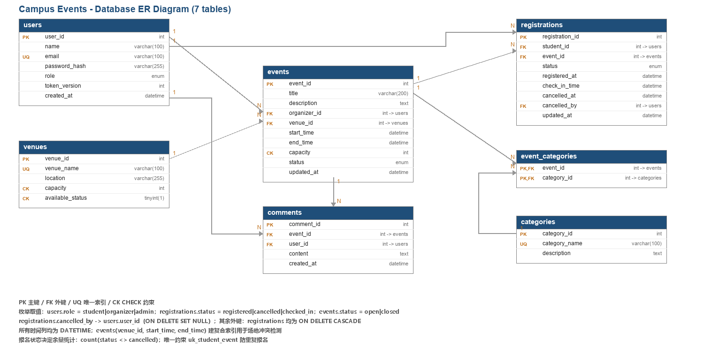

# 数据库设计说明（ER / 范式 / 索引 / 示例查询 / 性能实测）

下面写的都和 `database/schema.sql`、`backend/app.py` 里的实现对得上，可以对着库一条条验证。

---

## 1. 系统结构概览

```
浏览器（原生 JS，Flask 托管 frontend/*.html）
        │  fetch + Authorization: Bearer <token>
        ▼
Flask 应用（backend/app.py）
   ├─ 认证层    itsdangerous 签名令牌 → user_id + token_version（登出/改密即失效）
   ├─ 校验层    AppError 统一业务异常；邮箱/角色/时间/容量/场地冲突校验
   ├─ 事务层    db_cursor(commit=True)：开连接→游标→提交/回滚→归还连接
   └─ 数据层    mysql-connector 连接池（默认 5）+ 参数化 SQL（无字符串拼接注入面）
        │
        ▼
MySQL 8.0（utf8mb4 / InnoDB / REPEATABLE-READ）
   7 张业务表：users, venues, events, registrations, categories, event_categories, comments
```

关键并发控制点（这块是课程要求的重点）：

| 场景 | 手段 |
| --- | --- |
| 报名不超卖 | `SELECT ... FROM events WHERE event_id=? FOR UPDATE` 锁活动行、计数、写报名，三步在同一个事务里 |
| 场地不被重复预订 | `SELECT ... FROM venues WHERE venue_id=? FOR UPDATE` 先锁场地行，再做时间段交集检测（串行化同场地发布） |
| 缩容不超卖 | 编辑活动时锁定活动行 + 对报名做锁定读 `COUNT(*) ... FOR UPDATE` |
| 状态不被覆盖 | 取消/签到/移出均为 `SELECT ... FOR UPDATE` + `UPDATE ... WHERE status='registered'` 并校验 `rowcount` |
| 死锁规避 | 删除活动与报名统一先锁 `events` 行，保持同一加锁顺序 |

---

## 2. ER 图



（图片由 `scripts/er_diagram.py` 按 `database/schema.sql` 画出来，改了表结构重跑一下就行。）

实体关系：

- `users` 1:N `events`（组织者发布活动）
- `venues` 1:N `events`（一个场地承载多个活动，同一时间段只能有一个）
- `users` 1:N `registrations` N:1 `events`（学生 ↔ 活动，多对多经报名表承载，`UNIQUE(student_id, event_id)`）
- `events` 1:N `event_categories` N:1 `categories`（活动 ↔ 分类，多对多）
- `events` 1:N `comments`、`users` 1:N `comments`
- `registrations.cancelled_by` → `users.user_id`（取消操作人，`ON DELETE SET NULL`）

---

## 3. Schema 设计与范式说明

### 3.1 设计要点

| 设计决策 | 理由 |
| --- | --- |
| `registrations` 用状态 + 时间戳建模，而不是物理删除 | 报名/取消/签到是业务事件，删除会丢失考勤凭据；`status` 枚举 + `registered_at / check_in_time / cancelled_at / cancelled_by / updated_at` 可完整还原 |
| `events.status` 只存 `open/closed`（人工开关），"是否开始/结束"由 `NOW()` 派生 | 开始/结束是时间函数，落库需要定时任务维护，容易与真实时间不一致；改为查询期计算（`started` / `ended`）避免状态腐坏 |
| 容量约束两层：`CHECK (capacity > 0)` + 应用层保证报名数 ≤ 容量 | DB 只能保证单行合法性，"报名数"是跨行聚合，需事务 + 行锁保证 |
| 场地冲突用 `(venue_id, start_time, end_time)` 复合索引 + 应用层交集检测 | 区间重叠是跨行约束，MySQL 无法用普通 UNIQUE 表达（需要 trigger 或额外 booking 表） |
| 时间列统一 `DATETIME`，连接固定会话时区 `+08:00` | 避免 `TIMESTAMP` 的会话时区换算与 2038 上限，`NOW()` 与页面时间一致 |
| 表名、列名统一小写 | 兼容 `lower_case_table_names=0` 的 Linux / macOS MySQL |

### 3.2 范式

- 1NF：所有列都是原子值，活动和分类的多值关系拆到 `event_categories`，没把分类拼成逗号串塞一列。
- 2NF：`event_categories` 的主键是 `(event_id, category_id)`，表里就这两列，不存在部分依赖。
- 3NF：非主属性不传递依赖。比如 `events` 不冗余存 `venue_name`，而是查询时 JOIN 出来，场地改名后不会出现两份不一致的名字。
- 有一处是故意不做冗余的：列表接口用相关子查询实时算 `registered_count`，没在 `events` 上存计数列。因为报名数变得很频，冗余列容易漂移，当前数据量下子查询的代价可以接受（见 §5）。
- 总体：所有业务表都是 3NF，`event_categories` 是纯连接表，也满足 BCNF。

### 3.3 约束一览

下面这些都是能在数据库层强制的。

| 约束 | 位置 | 作用 |
| --- | --- | --- |
| `UNIQUE(email)` | users | 邮箱唯一，注册防重 |
| `UNIQUE(venue_name)` / `UNIQUE(category_name)` | venues / categories | 主数据不重复 |
| `CHECK(capacity > 0)` | events / venues | 容量必须为正 |
| `CHECK(end_time > start_time)` | events | 时间区间合法 |
| `CHECK(available_status IN (0,1))` | venues | 布尔语义约束 |
| `UNIQUE(student_id, event_id)` | registrations | 防重复报名（并发下的最后一道闸） |
| 外键 `ON DELETE CASCADE` | comments / event_categories / registrations | 删除活动时级联清理，不留孤儿数据 |
| 外键 `ON DELETE SET NULL` | registrations.cancelled_by | 删除用户不破坏报名历史 |

---

## 4. 索引策略

### 4.1 索引清单

| 索引 | 服务的查询 | 说明 |
| --- | --- | --- |
| `PRIMARY(event_id)` 等主键 | 详情、按 id 更新/删除 | InnoDB 聚簇索引 |
| `registrations.uk_student_event(student_id, event_id)` | 判断是否已报名、定位取消的那条记录+ 唯一性 | 唯一索引同时承担去重语义 |
| `registrations.idx_reg_event_status(event_id, status)` | 报名人数统计、报名名单分页 | 覆盖 `event_id` 前缀，`status` 用于过滤取消 |
| `registrations.idx_reg_cancelled_by(cancelled_by)` | 外键约束所需 + 按操作人审计 | |
| `events.idx_start_time(start_time)` | 活动列表按时间排序 | 排序键可用索引（见 §5 对比） |
| `events.idx_events_venue_time(venue_id, start_time, end_time)` | 场地时间冲突检测 | 前缀等值 + 后两列范围，`Using index` 覆盖扫描 |
| `events.idx_events_org_start(organizer_id, start_time)` | 组织者查看自己的活动 | 给以后的我的活动列表预留 |
| `comments.idx_comments_event_created(event_id, created_at)` | 评论分页（按时间倒序） | 支持 `Backward index scan`，免 filesort |
| `comments.idx_event(event_id)` / `user_id` | 外键 + 按活动/用户查评论 | |
| `categories.uk_category_name`、`venues.uk_venue_name` | 唯一性 + 名称查找 | |

### 4.2 已知局限

`GET /api/events` 使用
`ORDER BY (e.end_time < NOW()) ASC, e.start_time ASC`（把已结束活动排到最后），
排序键含表达式，MySQL 无法用 `idx_start_time` 完成排序，会退化成全表扫 + filesort（§5 实测 3000 行时仍为毫秒级）。
排序键里带了表达式，MySQL 用不上 `idx_start_time`，只能全表扫 + filesort（3000 行实测还是毫秒级）。
要彻底解决就得把是否已结束物化成一个可索引的列（定时任务或写的时候维护），
或者拆成未结束 / 已结束两条查询拼分页。这个数据量没必要，先留着并写在这。

### 4.3 示例查询

下面这些 SQL 可以直接在 MySQL Workbench 里跑。

```sql
-- 1) 活动大厅：余量、是否已报名、是否开始/结束（列表接口核心查询）
SELECT e.event_id, e.title, e.start_time, e.end_time, e.capacity, e.status,
       v.venue_name,
       (NOW() > e.start_time) AS started,
       (e.end_time < NOW())   AS ended,
       (SELECT COUNT(*) FROM registrations r
         WHERE r.event_id = e.event_id AND r.status <> 'cancelled') AS registered_count,
       (SELECT COUNT(*) FROM registrations r
         WHERE r.event_id = e.event_id AND r.student_id = 1
           AND r.status <> 'cancelled') AS is_registered
  FROM events e LEFT JOIN venues v ON e.venue_id = v.venue_id
 ORDER BY (e.end_time < NOW()), e.start_time
 LIMIT 12 OFFSET 0;

-- 2) 场地时间冲突检测（编辑活动时排除自身 event_id）
SELECT event_id FROM events
 WHERE venue_id = 3 AND event_id <> 42
   AND start_time < '2027-06-01 12:00:00'
   AND end_time   > '2027-06-01 10:00:00'
 LIMIT 1;

-- 3) 某活动的有效报名名单（分页 + 签到状态）
SELECT r.registration_id, u.name, u.email, r.status, r.registered_at, r.check_in_time
  FROM registrations r JOIN users u ON r.student_id = u.user_id
 WHERE r.event_id = 42 AND r.status <> 'cancelled'
 ORDER BY r.registered_at, r.registration_id
 LIMIT 20 OFFSET 0;

-- 4) 取消留痕审计（谁在什么时候取消了谁的报名）
SELECT r.registration_id, s.name AS student, c.name AS cancelled_by, r.cancelled_at
  FROM registrations r
  JOIN users s ON r.student_id = s.user_id
  LEFT JOIN users c ON r.cancelled_by = c.user_id
 WHERE r.event_id = 42 AND r.status = 'cancelled'
 ORDER BY r.cancelled_at DESC;

-- 5) 出勤率统计（签到数 / 有效报名数）
SELECT e.event_id, e.title,
       COUNT(*) AS active_regs,
       SUM(r.status = 'checked_in') AS checked_in,
       ROUND(SUM(r.status = 'checked_in') / COUNT(*) * 100, 1) AS rate_pct
  FROM events e JOIN registrations r ON r.event_id = e.event_id
 WHERE r.status <> 'cancelled'
 GROUP BY e.event_id, e.title
 ORDER BY rate_pct DESC;

-- 6) 组织者的活动与其报名规模
SELECT e.event_id, e.title, e.start_time,
       COUNT(r.registration_id) AS regs
  FROM events e LEFT JOIN registrations r
    ON r.event_id = e.event_id AND r.status <> 'cancelled'
 WHERE e.organizer_id = 2
 GROUP BY e.event_id, e.title, e.start_time
 ORDER BY e.start_time DESC;
```

---

## 5. 性能实测

测试方法：`scripts/bench_queries.py` 在临时库 `campus_events_bench` 里造数据
（3000 个活动 / 9000 条报名 / 4000 条评论 / 500 个用户），
同一批 SQL 分别保留 schema 索引、把索引删掉各跑 15 次取中位数，
同时用 `EXPLAIN` 记下访问计划。机器是 Windows 11 + MySQL 8.0.46，buffer pool 默认值。

| 查询 | 有索引 | 无索引（对照） | EXPLAIN 关键差异 |
| --- | --- | --- | --- |
| 活动列表（`ORDER BY (end_time<NOW()), start_time`） | **1.17 ms** | 1.11 ms | 两者都 `type=ALL, rows=3000, Using filesort` ⇒ **表达式排序导致索引失效** |
| 活动列表（仅 `ORDER BY start_time`） | **0.38 ms** | 0.87 ms | 有索引：`idx_start_time, rows=12`（只扫 12 行）；无索引：全表 + filesort |
| 场地时间冲突检测 | **0.28 ms** | 0.58 ms | 有索引：`idx_events_venue_time, rows=600, Using index`；无索引：`PRIMARY, rows=1501` |
| 某活动有效报名人数 | **0.12 ms** | 0.11 ms | 无索引时仍可走 `registrations.event_id` 索引，差距不明显 |
| 活动评论分页 | **0.11 ms** | 0.12 ms | 有索引：`Backward index scan`（免 filesort）；无索引：`Using filesort` |

结论：

1. 复合索引在等值 + 范围的查询上最管用：场地冲突检测从扫 1501 行降到 600 行的覆盖索引扫描，耗时少了一半，数据量涨 10 倍差距会线性放大。
2. 排序键里带函数或表达式，索引直接失效。活动列表如果把 `ORDER BY` 改成纯 `start_time`，扫描行数从 3000 降到 12（差 3 倍左右，而且和总行数无关）。这是本项目已知的性能取舍，原因和解法见 §4。
3. 索引不是越多越好，每条索引都会增加写入和磁盘开销。`idx_reg_event_status` 在按活动计数上和单列 `event_id` 索引效果差不多，留着主要是为了 `(event_id, status)` 的覆盖过滤。
4. 登录慢是 bcrypt 的问题（约 200ms，安全性代价），不是 SQL。加连接池之后单接口 P99 在 10ms 内（本机、3000 活动规模）。
5. 并发安全优先于吞吐：报名串行在活动行锁上，容量 1 的活动两个线程并发报名实测严格是一个成功、一个提示名额已满，用一点并发度换正确性，选课场景这样合适。

复现命令：

```bash
python scripts/bench_queries.py     # 造数 + 对照测量 + 自动删除临时库
python -m pytest tests --cov=app --cov-report=term-missing   # 功能与覆盖率
```
