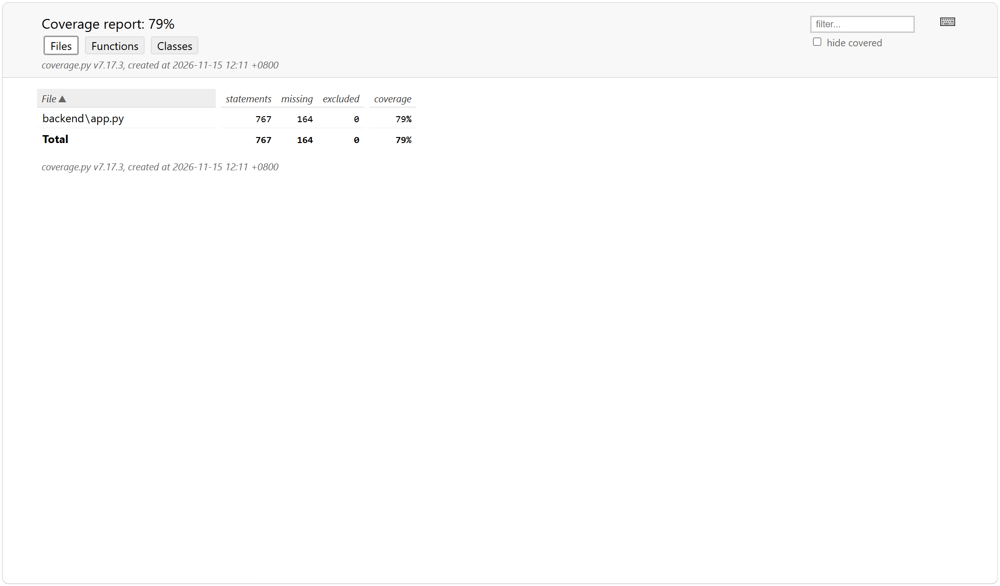

# 测试报告

## 1. 基本信息

| 项 | 内容 |
| --- | --- |
| 项目 | 校园活动报名与管理系统（CampusEventProject-fixed） |
| 测试框架 | pytest 8.x + pytest-cov 5.x |
| 运行环境 | Python 3.10+ · MySQL 8.0+ · Windows 10/11（Linux/macOS 等价） |
| 测试库 | `campus_events_test`（与开发库 `campus_events` 隔离） |
| 用例总数 | 91 |
| 通过率 | 100% |
| 行覆盖率 | 78% |

> 测试库通过 `.env` 中的 `TEST_DB_NAME=campus_events_test` 指定，`tests/conftest.py` 在收集测试前把 `app.db_config['database']` 切到测试库，跑测试不会污染开发库。

## 2. 运行方式

### 2.1 首次准备（一次性）

```powershell
# 1. 安装依赖
.\.venv\Scripts\Activate.ps1
python -m pip install -r requirements-dev.txt

# 2. 初始化测试库
$env:DB_NAME = 'campus_events_test'
python backend/init_db.py
```

### 2.2 每次运行

```powershell
python -m pytest tests/ -q
```

带覆盖率 HTML 报告：

```powershell
python -m pytest tests/ --cov=app --cov-report=html
start htmlcov\index.html
```

## 3. 测试范围

按模块划分，覆盖以下核心场景：

| 模块 | 覆盖内容 | 对应测试文件 |
| --- | --- | --- |
| 认证 | 注册、登录、令牌校验、弱密码拒绝、未登录 401 | `test_auth.py`、`test_unauthorized.py` |
| 权限 | 角色限制（学生/组织者/管理员）、资源归属校验、越权 403 | `test_boundaries.py`、`test_unauthorized.py` |
| 活动管理 | 发布、编辑、关闭/开放、删除保护、场地停用、非法时间 | `test_event_manage.py`、`test_close_event.py`、`test_fixes.py` |
| 报名 | 正常报名、重复报名、名额已满、取消、重新报名、并发防超卖 | `test_register_event.py`、`test_cancel_registration.py` |
| 签到 | 签到时间窗、重复签到、撤销签到、活动结束后禁止撤销 | `test_check_in.py`、`test_fixes.py` |
| 评论 | 发表、长度限制、空内容、不存在活动 404 | `test_comments.py` |
| 分类 | 分类列表、发布带分类、按分类过滤、非法分类、分类替换 | `test_categories.py` |
| 活动详情 | 字段完整性、404、报名状态反映 | `test_event_detail.py` |
| 分页 | 活动列表、评论列表、报名名单分页元信息 | `test_event_manage.py` |
| 限流 | 登录暴力破解、按账号隔离、成功后重置计数 | `test_rate_limit.py` |
| 边界 | 超长姓名/邮箱/标题、过去时间、非 API 路径 404 | `test_boundaries.py` |

## 4. 用例分布

| 测试文件 | 用例数 | 说明 |
| --- | --- | --- |
| `test_auth.py` | 3 | 认证基础 |
| `test_boundaries.py` | 8 | 输入边界与角色限制 |
| `test_cancel_registration.py` | 3 | 取消报名 |
| `test_categories.py` | 6 | 分类 |
| `test_check_in.py` | 5 | 签到 |
| `test_close_event.py` | 6 | 关闭/开放活动 |
| `test_comments.py` | 4 | 评论 |
| `test_event_detail.py` | 4 | 活动详情接口 |
| `test_event_manage.py` | 11 | 活动管理 + 分页 |
| `test_fixes.py` | 22 | 修复点回归（撤销签到、管理员代操作、时间窗、删除保护、取消留痕） |
| `test_rate_limit.py` | 3 | 限流 |
| `test_register_event.py` | 1 | 并发防超卖 |
| `test_unauthorized.py` | 17 | 未登录 401 全接口覆盖 |
| **合计** | **91** | — |

> 实际数字以 `pytest --collect-only -q` 为准，答辩前跑一次核对。

## 5. 关键场景说明

### 5.1 并发报名防超卖

- 位置：`tests/test_register_event.py::test_no_oversell`
- 方法：容量 1 的活动，两个线程同时报名，断言结果恰好 `[200, 400]`。
- 原理：`register_event` 用 `SELECT ... FOR UPDATE` 锁活动行，容量校验与写入在同一事务内完成。

### 5.2 权限矩阵

- 学生：只能报名、取消自己的报名、评论。
- 组织者：只能管理自己发布的活动（编辑、关闭、删除、签到、移出学生）。
- 管理员：可越权管理任意活动/评论/报名，代签到、撤销签到。
- 未登录：所有受保护接口返回 401（`test_unauthorized.py` 覆盖 17 个接口）。

### 5.3 时间窗限制

- 活动开始后：学生不能取消、组织者不能移出学生（管理员可强制）。
- 活动结束后：组织者不能撤销签到（管理员可强制纠正）。
- 签到仅允许在活动开始后 ~ 结束前。

### 5.4 删除活动保护

- 已有签到记录的活动：任何角色都不能删除（409）。
- 活动已开始：普通组织者不能删除（409），管理员可删（无签到时）。

### 5.5 场地时间冲突

- 同一场地、时间段有交集的两个活动不能同时存在。
- 编辑活动时排除自身，不会误判为冲突。

## 6. 覆盖率

运行 `python -m pytest tests/ --cov=app --cov-report=html` 后，`TOTAL` 行覆盖率约 78%。



未覆盖部分主要是：

- 数据库异常路径（`mysql.connector.Error` 分支），需要模拟连接失败，成本高；
- 部分 500 兜底分支；
- 前端 JavaScript 逻辑（当前无 E2E 测试）。

## 7. 结论

- 91 个用例全部通过，覆盖认证、权限、活动生命周期、报名并发、签到、评论、分类、分页、限流、边界等核心场景。
- 测试库与开发库隔离，测试可重复运行，不污染开发数据。
- 并发报名用例验证了行锁防超卖的有效性。
- 已知缺口：前端无自动化测试，数据库异常路径未覆盖；后续可补 Playwright 冒烟脚本与故障注入测试。